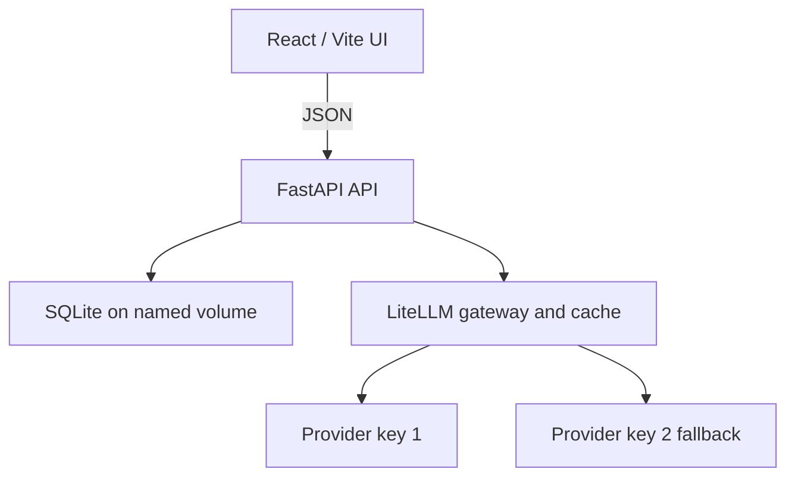

# NEXORA AI — Intelligence without interruption

A full-stack AI workspace demonstrating multi-provider failover, LiteLLM caching, multi-turn SQLite persistence, request-level token metadata and a developer failure-simulation playground.

## 1. Live URLs
Add your deployed frontend and backend URLs here after deployment.

## 2. Run locally: with Docker and without

### Docker
1. Copy `.env.example` to `.env`.
2. Add at least two valid provider API keys to `LLM_API_KEYS`.
3. Run `make up`.
4. Open http://localhost:3000. Backend: http://localhost:8000.

Stop with `make down`.

### Without Docker
Backend:
```bash
cd backend
python -m venv .venv
source .venv/bin/activate
pip install -r requirements.txt
export LLM_API_KEYS="key1,key2"
export DATABASE_URL="sqlite:///./app.db"
uvicorn app.main:app --reload --port 8000
```
Frontend:
```bash
cd frontend
npm install
npm run dev
```

## 3. Design decisions: key fallback, caching, SQLite session storage

- FastAPI exposes the required `/health`, `/chat`, and `/sessions/{session_id}/messages` routes.
- LiteLLM is configured with its local cache. A small process-local response index retains the original response usage and reliably labels exact cache hits.
- Provider keys are attempted in configured order. Retryable provider errors move to the next key; secrets are never returned.
- SQLite stores user and assistant messages. The Compose named volume mounted at `/data` preserves the database across container restarts.
- The browser creates a fresh session ID on page load and sends only the new message.
- The reliability dashboard shows browser-session metrics, not global infrastructure statistics.

### Architecture


## 4. Verification: how to see failover, cache hits and per-message token usage

- Send the same first message from two fresh sessions to exercise the response cache.
- Send a different message to verify cache-key separation.
- In Developer Playground, run `key_1=429` or `key_1=500`; with valid provider keys, the second key should answer.
- Run `*=429`; expect HTTP 503 and no history insertion.
- Each assistant reply displays source, model, latency and per-request token usage.
- Run backend tests with `cd backend && pytest`.

Example:
```bash
curl -X POST http://localhost:8000/chat \
  -H 'Content-Type: application/json' \
  -d '{"session_id":"demo-1","message":"Explain caching"}'
```

## 5. Setup Used: your editor and AI tools
Document the editor and AI tools actually used for your submission.

## 6. Bonus features (if any): what you added beyond the requirements and why
- Reliability Center for configuration and session-level performance.
- Developer Playground for the assignment's failure simulation header.
- Distinctive responsive SaaS interface, prompt suggestions and system prompt editor.

## Environment variables
See `.env.example`. Never commit `.env` or real API keys.

## Important implementation notes
The response cache in this starter is process-local and resets when the backend process restarts. LiteLLM's built-in local cache is enabled as well. For a multi-worker or multi-instance deployment, use a shared cache backend supported by LiteLLM while retaining the assignment's SQLite-only storage constraint. Confirm provider/model compatibility and test with two independently valid keys before submission.
